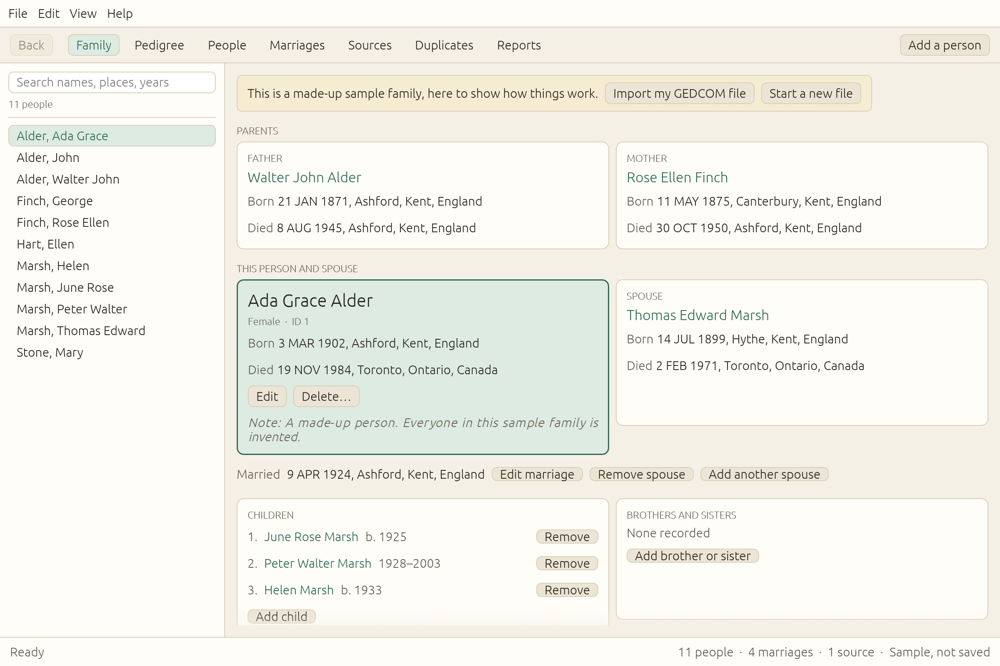

# Family File

A family history program for current macOS, Windows and Linux: people, marriages, events,
sources, notes and photos, with family and pedigree views, search, duplicate merging,
printable reports, and GEDCOM import and export.

Family File is an attempt to recreate **Personal Ancestral File (PAF)**, the free genealogy program
from FamilySearch that was discontinued in 2013 and no longer runs well on current computers. It
aims to keep PAF's simple way of working (one family at a time, pedigree view, plain records)
on today's systems.

It is an independent project, written from scratch. It contains no PAF code and is not affiliated
with, endorsed by, or supported by FamilySearch or The Church of Jesus Christ of Latter-day Saints.



## Download

Get the latest version from the **Releases** page of this repository:

- **macOS** (Apple Silicon and Intel): `Family-File-macOS.zip`. Unzip it and drag *Family File* to
  Applications. The app isn't notarized by Apple, so the first time, Control-click it, choose
  **Open**, then **Open** again.
- **Windows**: `Family-File-Windows.zip`. Unzip and run `family-file.exe`.
- **Linux** (x86_64): `Family-File-Linux-x86_64.tar.gz`. Unpack and run `family-file`.

## Building

Install Rust from https://rustup.rs, then in this folder:

- `cargo run --release` builds and starts the program. The program itself is `target/release/family-file`.
- On a Mac, `scripts/make-macos-app.sh` builds `dist/Family File.app`, which runs on both Apple
  Silicon and Intel Macs. `scripts/make-macos-app.sh --zip` also makes the zip used for releases.
  `cargo bundle --release` (from `cargo install cargo-bundle`) works too and makes an app for your
  own Mac only.
- On Linux you also need the usual desktop libraries (X11 or Wayland, and a graphics driver with
  Vulkan or OpenGL). On Debian/Ubuntu: `sudo apt install libxkbcommon-dev libgtk-3-dev`.

Run the tests with `cargo test`.

## Releasing

`.github/workflows/build.yml` tests and builds on macOS, Windows and Linux on every push. To publish a
release, set the version in `Cargo.toml`, commit, then tag and push:

```
git tag v0.1.0
git push origin v0.1.0
```

GitHub builds all three systems and attaches the downloads to a new release.

## Your data

- Family files end in `.familyfile`. Each save keeps the previous version beside it as `.backup`.
- GEDCOM import reads ANSEL, UTF-8, UTF-16 and Windows Latin. Details the program has no field
  for are kept and written back out on export.
- Old `.paf` files can't be opened directly. Export them as GEDCOM from the old program first.

## Options

- `--screenshot <file.png>` starts normally, draws 120 frames, saves a picture and exits.
- `--show <screen>` starts on one screen: family, pedigree, people, marriages, sources, duplicates,
  reports, edit-person, edit-marriage, add-relative, edit-source, delete or empty.

## License

MIT. See [LICENSE](LICENSE).
